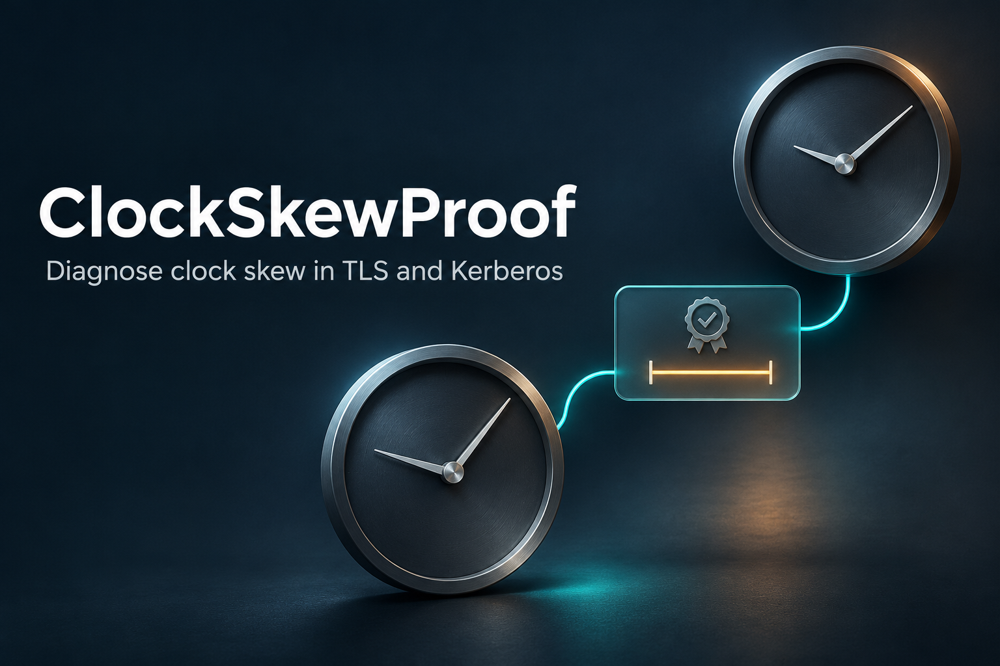
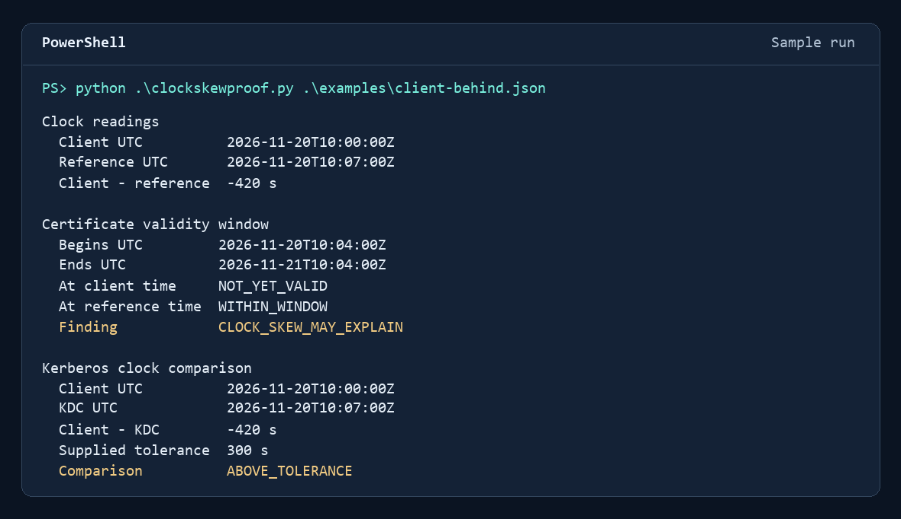
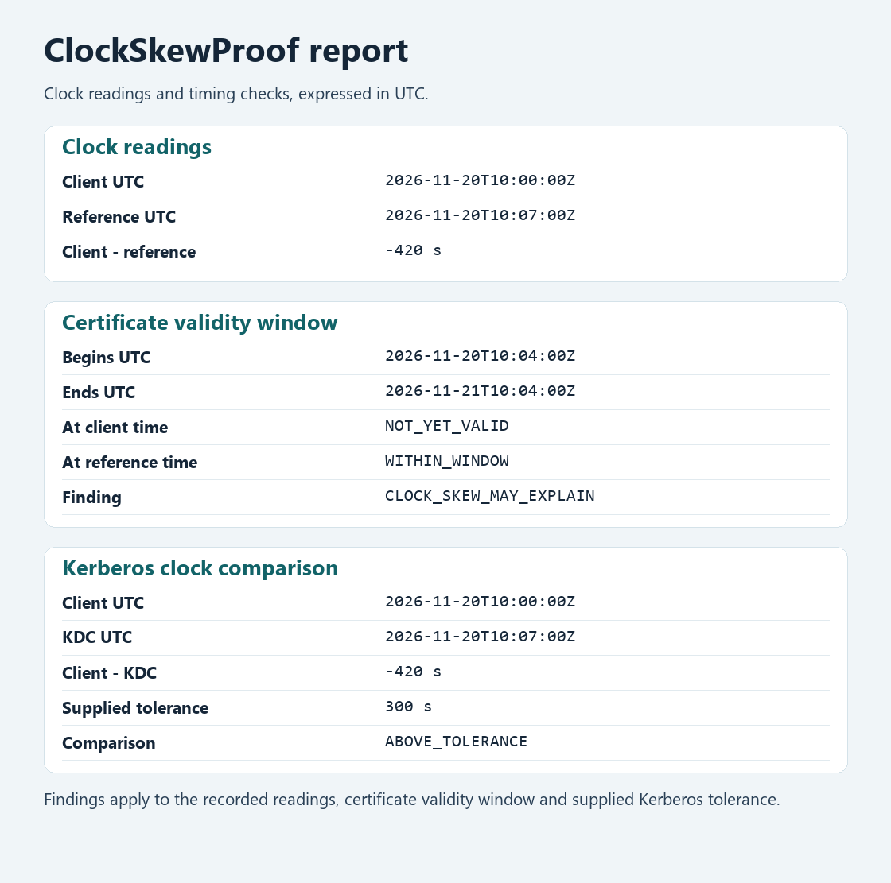

# ClockSkewProof



Check whether captured clock skew can explain a certificate's timing result
and compare the client clock with a supplied Kerberos tolerance.

ClockSkewProof uses Python 3.10 or newer and the standard library. Run an
offline check from saved readings or capture a read-only NTP sample from a
server you specify. Windows can read the validity dates from a public
certificate file.

## Run the sample

```powershell
python .\clockskewproof.py .\examples\client-behind.json
python .\clockskewproof.py .\examples\client-behind.json --format json
python .\clockskewproof.py .\examples\client-behind.json --format html |
  Set-Content -Encoding UTF8 .\example-report.html
```

The synthetic example puts the client seven minutes behind the reference. The
certificate's time window has begun at the reference time and is still in the
future at the client time. The separate client-to-KDC comparison exceeds the
supplied five-minute tolerance.

## Output previews

The previews show the CLI output and HTML report for the bundled synthetic
sample.





## Capture live readings

Specify an approved NTP reference. For a Kerberos timing check, also specify
the domain controller involved and its effective clock tolerance in seconds.
On Windows, `--certificate` reads a public DER certificate or a PEM file
containing a single certificate.

```powershell
python .\clockskewproof.py --reference time.example.test --kdc dc.example.test --kerberos-tolerance-seconds 300 --certificate .\server.cer --format html |
  Set-Content -Encoding UTF8 .\clock-report.html
```

Replace the example hostnames, certificate path, and tolerance with your
observations and policy value. The default port is UDP 123. Custom NTP
services can use `--reference-port` and `--kdc-port`. A reference and
controller with the same address and port share one sample.

Capture a JSON record for later analysis with `--format evidence`.

```powershell
python .\clockskewproof.py --reference time.example.test --format evidence |
  Set-Content -Encoding UTF8 .\clock-evidence.json
python .\clockskewproof.py .\clock-evidence.json --format json
```

## Supply evidence

- `client_time` and `reference_time` are the corresponding readings for a
  single observation. Collect them as close together as practical and use
  a reference clock you already trust.
- The optional `certificate` object contains the certificate's `not_before`
  and `not_after` timestamps.
- The optional `kerberos` object contains `kdc_time` for the domain
  controller involved in the check and its effective `tolerance_seconds`.
  Use its policy value. Enter the tolerance as a positive integer in seconds.
- Live captures include a reference measurement and, when selected, a
  controller measurement with its paired client reading. You can replay that
  evidence with the same offline command. For a separate manual KDC
  observation, set `kerberos.client_time` to its paired client reading.
- Include seconds and an explicit timezone on every timestamp. For example,
  use `2026-11-20T10:07:00Z` or `2026-11-20T12:07:00+02:00`.

Clock offsets are client minus reference or client minus KDC. A negative
offset means the client is behind. The certificate check covers the validity
interval, including both endpoints. The Kerberos check reports the magnitude
as below, at, or above the supplied boundary.

Live captures report round-trip delay and an estimated timing margin. The
margin uses half the measured round trip and the server's advertised delay
and dispersion. A margin that crosses a certificate or Kerberos boundary
produces `REFERENCE_NEAR_BOUNDARY` or `NEAR_TOLERANCE`. Use a trusted source
for NTP readings. Standard NTP provides an unauthenticated sample.

Treat `CLOCK_SKEW_MAY_EXPLAIN` as a finding about the time window using the
captured readings. Full TLS validation also depends on factors such as the
certificate chain and the host name.

Exit code `0` means the command produced a report or captured evidence.
Exit code `2` indicates an input or capture error. Automation can inspect
the findings with `--format json`.

## Run tests

```powershell
python -B -m unittest discover -s tests -v
```

The suite covers offline evidence, UTC offsets, validity and tolerance
boundaries, malformed NTP replies, timeouts, local UDP captures and replay.
The Windows tests use an example certificate in both PEM and DER form.

- [X.509 certificate validity in RFC 5280](https://www.rfc-editor.org/rfc/rfc5280#section-4.1.2.5)
- [NTP offset and delay in RFC 5905](https://www.rfc-editor.org/rfc/rfc5905#section-8)
- [Microsoft Kerberos clock synchronization policy](https://learn.microsoft.com/previous-versions/windows/it-pro/windows-10/security/threat-protection/security-policy-settings/maximum-tolerance-for-computer-clock-synchronization)

## Author and license

Created by [Alireza Foroughifar (@afrfuniverse)](https://github.com/afrfuniverse).
Available under the [MIT License](LICENSE).
